# Documentação DDD

Modelagem do **Sistema Integrado de Atendimento e Execução de Serviços** da oficina, na ordem em que foi construída:

1. a história de como a oficina trabalha (Domain Storytelling);
2. os eventos do domínio (Event Storming);
3. o desenho estratégico (subdomínios e contextos);
4. o tático (agregados e estados).

Os nomes vêm da [**Linguagem Ubíqua**](linguagem-ubiqua.md), que também traz o glossário, as entidades, os objetos de valor, os eventos no código e a relação de cada elemento com o arquivo em `src/`.

| Documento | Conteúdo | PDF |
|---|---|---|
| [Linguagem Ubíqua](linguagem-ubiqua.md) | Glossário, atores, bounded contexts, agregados, entidades, VOs, eventos, regras e relação com o código | — |
| [Domain Storytelling](domain-storytelling.md) | Histórias As-Is e To-Be na linguagem pictográfica + Antes × Depois | [diagramas.pdf](diagramas.pdf) (págs. 1–6) |
| Event Storming | Criação da OS, acompanhamento da OS, peças e insumos, acesso e equipe | [event-storming.pdf](event-storming.pdf) |
| Diagramas | Subdomínios, context map, agregados, máquinas de estado | [diagramas.pdf](diagramas.pdf) (págs. 7–10) |

## 1. Domain Storytelling

Como a oficina trabalha **hoje** (As-Is, com papel e telefone) e **com o sistema** (To-Be). As frases numeradas e as dores de cada passo estão em [domain-storytelling.md](domain-storytelling.md).

### As-Is

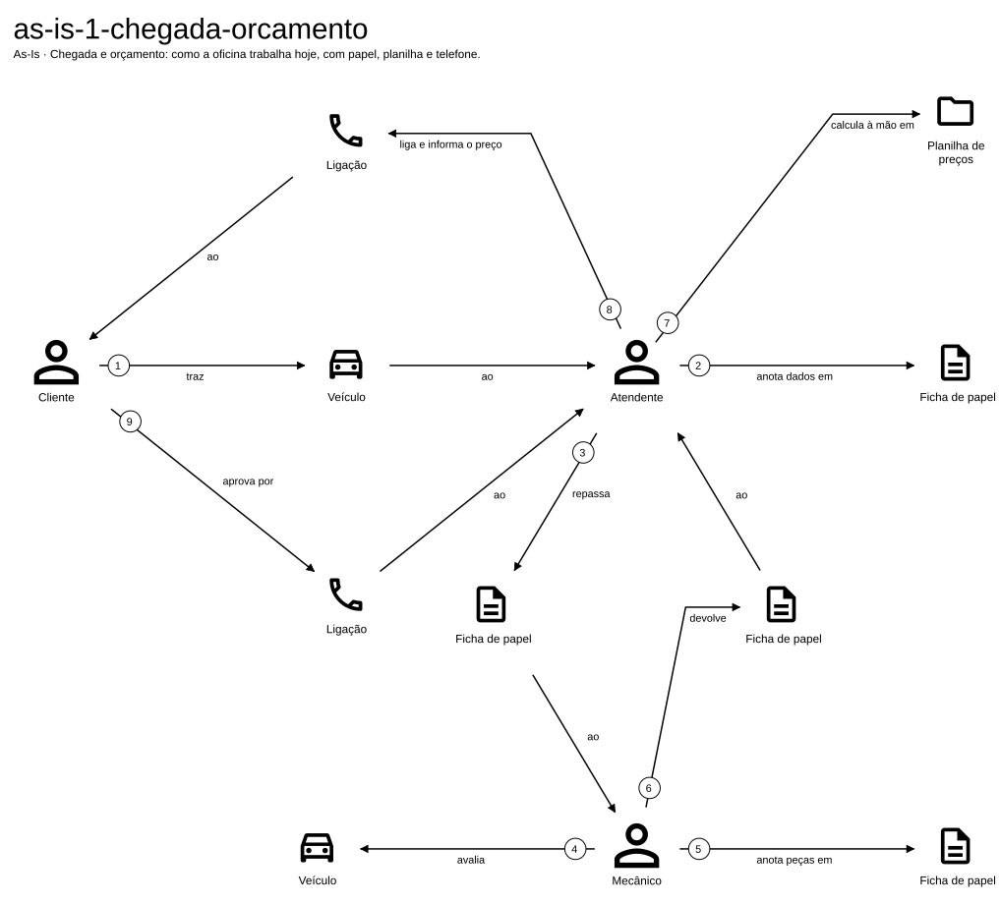
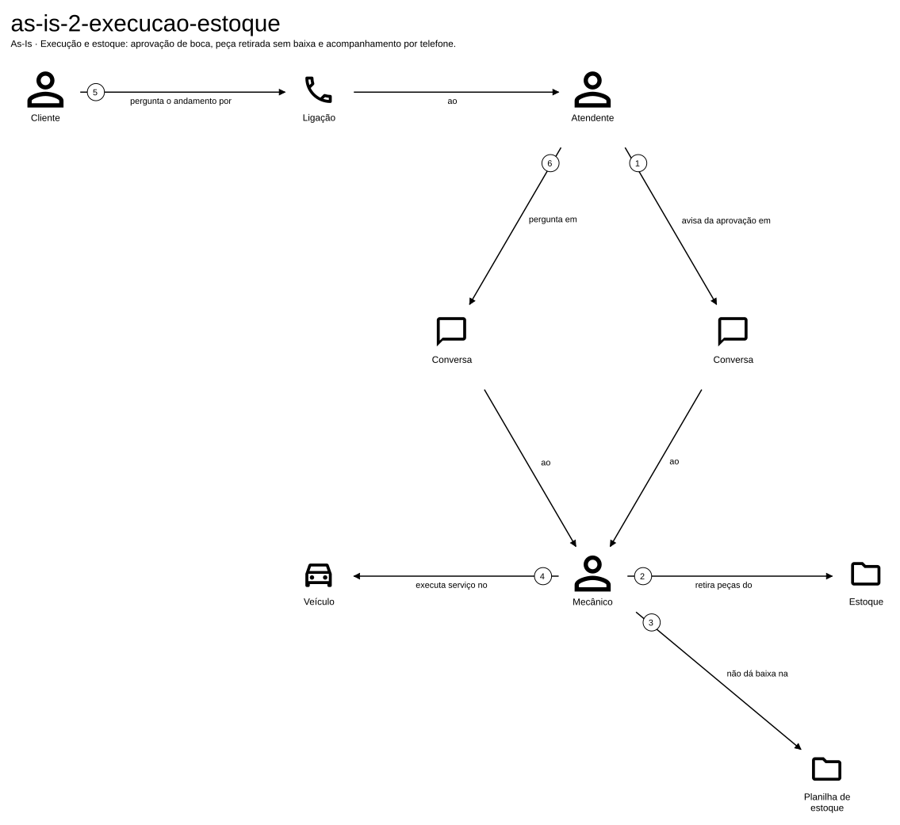
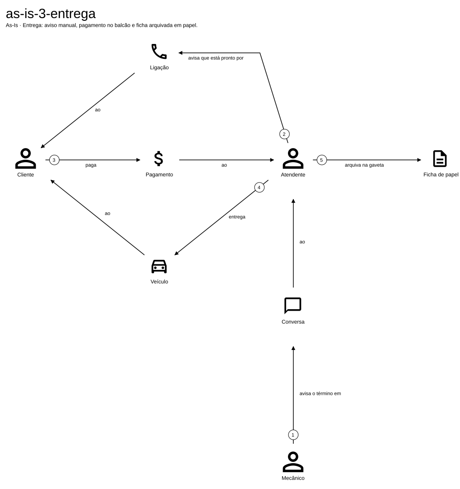

### To-Be

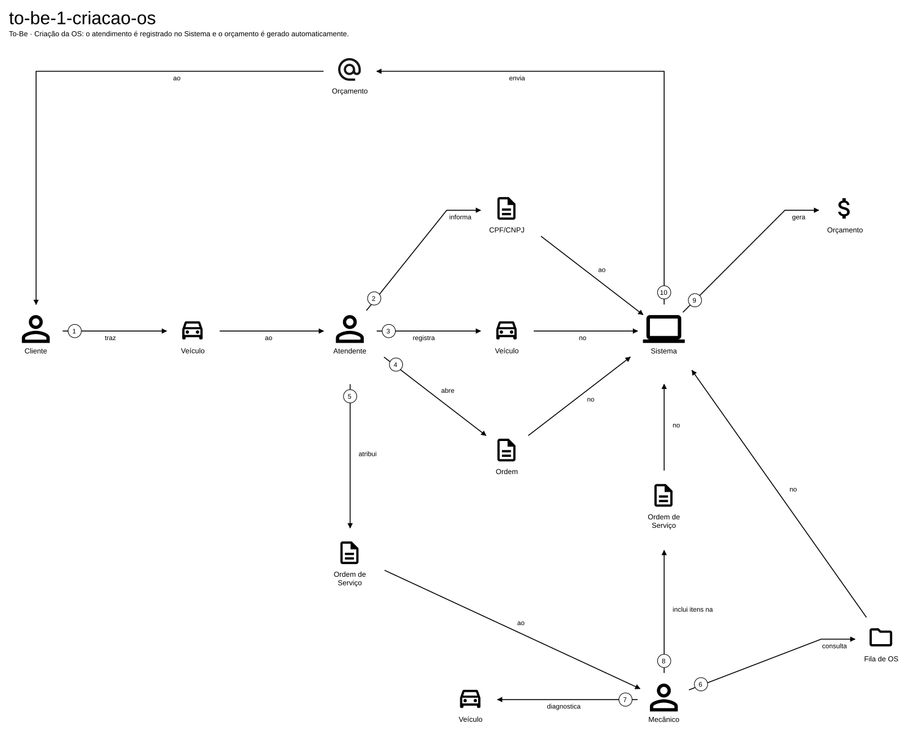
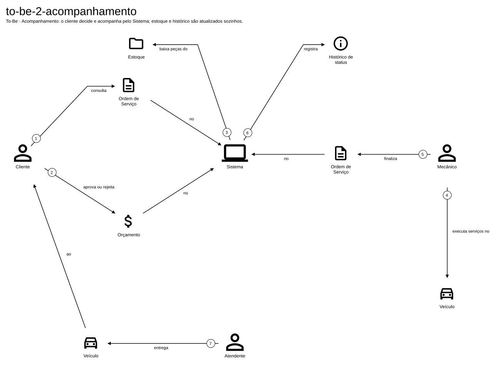
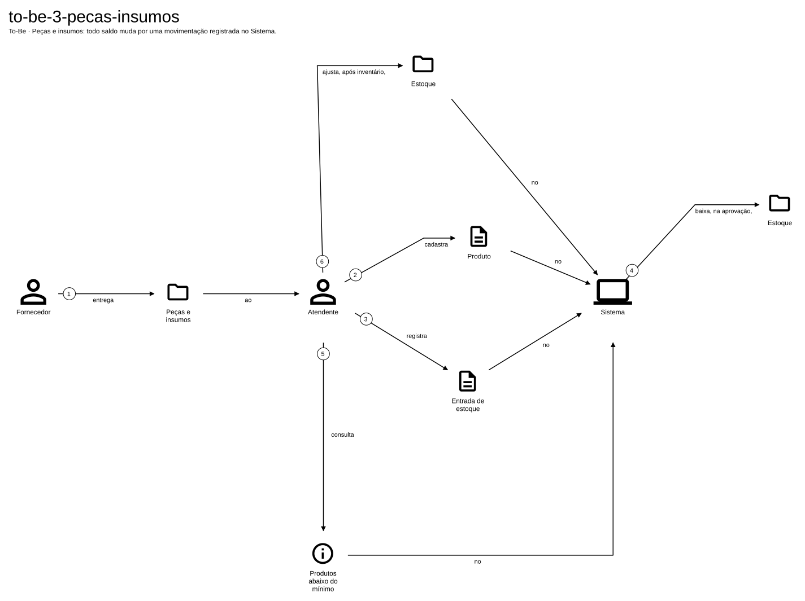

## 2. Event Storming

As tabelas equivalentes, em texto, estão em [Linguagem Ubíqua → Event Storming em texto](linguagem-ubiqua.md#event-storming-em-texto).

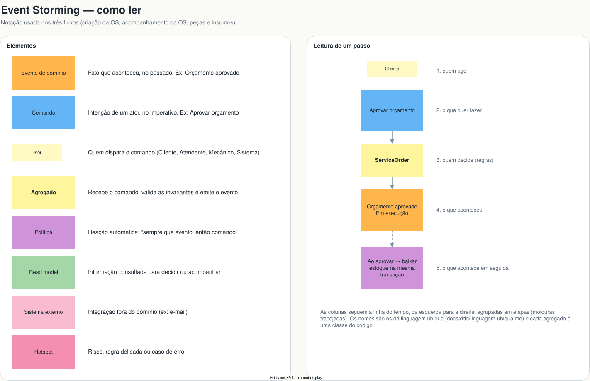


## 3. Subdomínios e Context Map

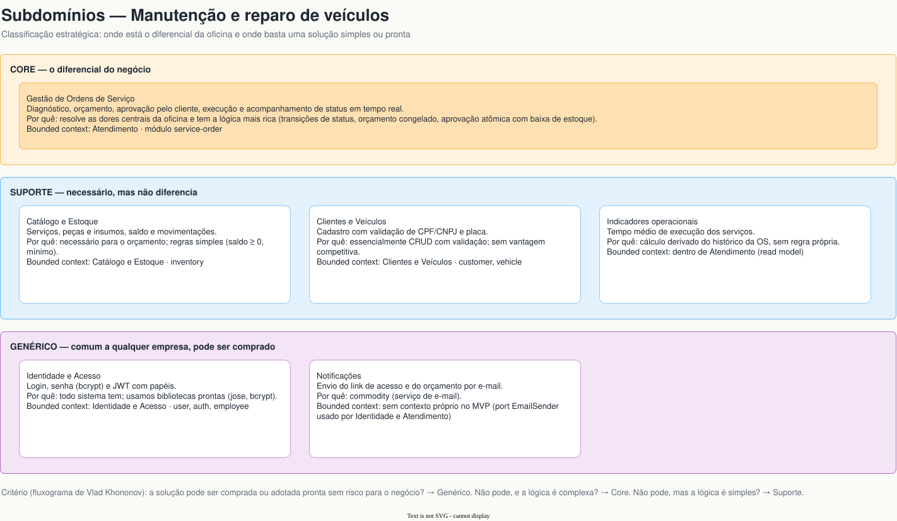
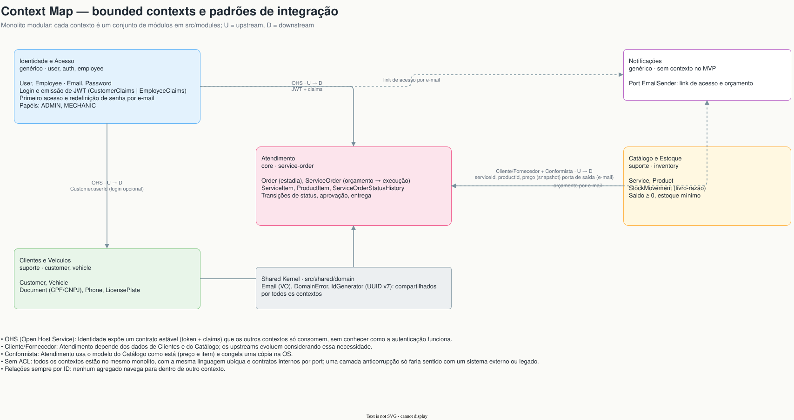

## 4. Agregados e máquinas de estado

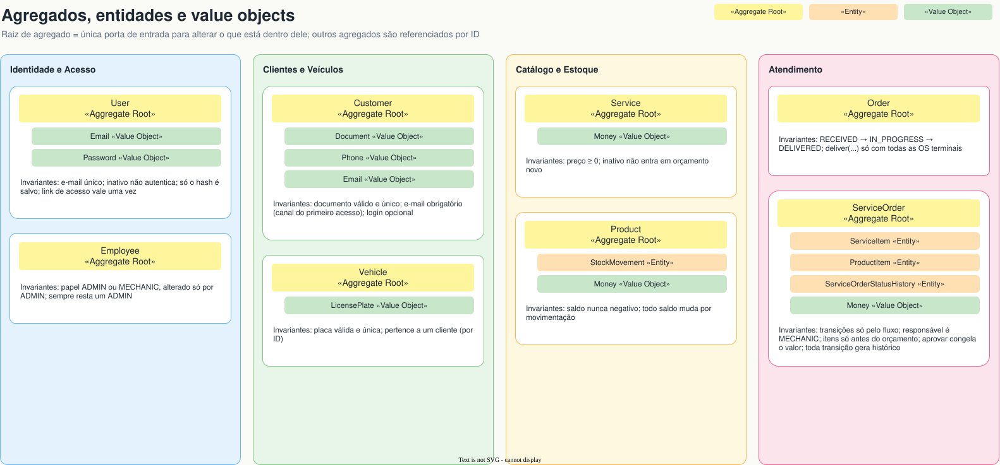
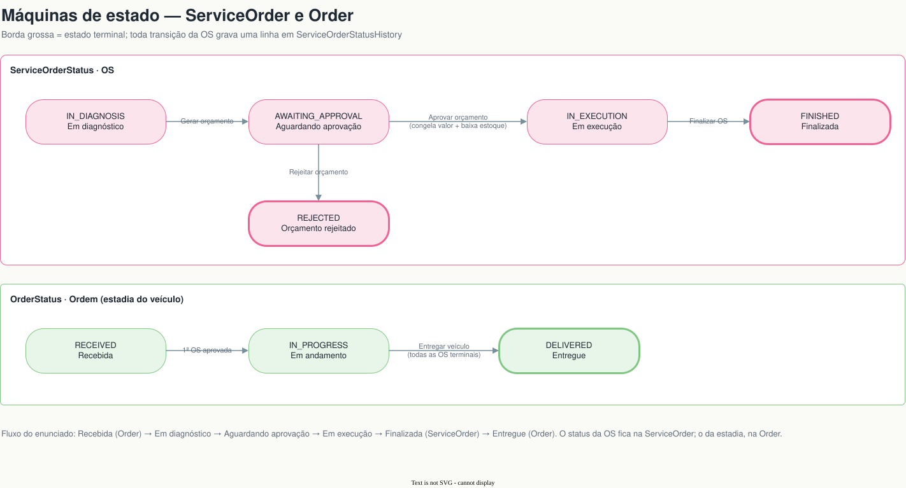

O modelo de dados (Prisma) está em [`../diagrams/database.svg`](../diagrams/database.svg).

## Como editar

As **fontes** são os arquivos `.drawio` e `.egn`. Os `.svg` e `.pdf` são **exportações**: nunca edite um SVG direto, edite a fonte e exporte de novo.

| Fonte | Ferramenta | Exportar |
|---|---|---|
| `event-storming.drawio`, `diagramas.drawio` | VS Code com a extensão [Draw.io Integration](https://marketplace.visualstudio.com/items?itemName=hediet.vscode-drawio), ou [app.diagrams.net](https://app.diagrams.net) | Uma página por SVG em `event-storming/` e `diagramas/`; PDF com todas as páginas |
| `domain-storytelling/*.egn` | VS Code com a extensão **Egon.io — The Domain Story Modeler** (Miragon), ou [egon.io](https://egon.io) | SVG com o mesmo nome, ao lado do `.egn` |

Os PDFs podem ser gerados pela linha de comando com o [draw.io desktop](https://github.com/jgraph/drawio-desktop/releases):

```bash
drawio -x -f pdf -a --crop -o docs/ddd/event-storming.pdf docs/ddd/event-storming.drawio
drawio -x -f pdf -a --crop -o /tmp/diagramas.pdf docs/ddd/diagramas.drawio
```

O `diagramas.pdf` é a junção das 6 histórias do Domain Storytelling com as 4 páginas do `diagramas.drawio`, nessa ordem (`pdfunite`).
