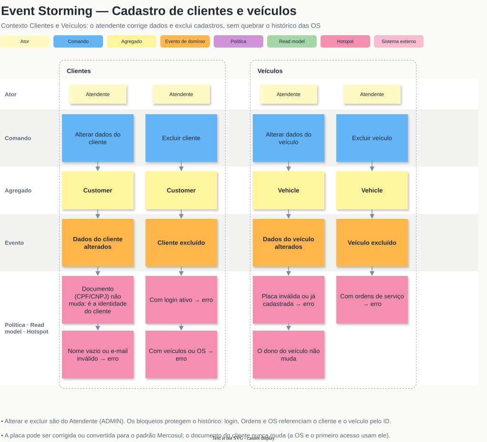

# Linguagem Ubíqua e Modelo de Domínio

Modelagem DDD do Sistema Integrado de Atendimento e Execução de Serviços da oficina. Este documento é a fonte dos nomes usados nos diagramas e no código: termo novo entra aqui antes de virar classe.

## Documentação visual

Todos os diagramas, em ordem e com imagem, estão no [índice da documentação DDD](README.md). Fontes e exports:

| Documento | Fonte | Imagens | PDF |
|---|---|---|---|
| Domain Storytelling As-Is e To-Be | `domain-storytelling/*.egn` (egon.io) | [`domain-storytelling/`](domain-storytelling/) | [diagramas.pdf](diagramas.pdf) |
| Event Storming (criação da OS, acompanhamento da OS, peças e insumos, acesso e equipe, cadastros) | [event-storming.drawio](https://viewer.diagrams.net/?nav=1&url=https%3A%2F%2Fraw.githubusercontent.com%2F18-SOAT%2FTech.Challenge.API%2Fmain%2Fdocs%2Fddd%2Fevent-storming.drawio) | [`event-storming/`](event-storming/) | [event-storming.pdf](event-storming.pdf) |
| Diagramas (subdomínios, context map, agregados, máquinas de estado) | [diagramas.drawio](https://viewer.diagrams.net/?nav=1&url=https%3A%2F%2Fraw.githubusercontent.com%2F18-SOAT%2FTech.Challenge.API%2Fmain%2Fdocs%2Fddd%2Fdiagramas.drawio) | [`diagramas/`](diagramas/) | [diagramas.pdf](diagramas.pdf) |
| Modelo de dados | [database.drawio](../diagrams/database.drawio) | [database.svg](../diagrams/database.svg) | — |

Os links do `.drawio` abrem no viewer do diagrams.net, sem login. Como editar e exportar está no [índice](README.md#como-editar).

## Atores

| Ator | No código | Papel no domínio |
|---|---|---|
| Cliente | `Customer` (`UserType.CUSTOMER`) | Traz o veículo, aprova ou rejeita o orçamento, acompanha a OS |
| Atendente | `Employee` + `EmployeeRole.ADMIN` | Atendimento e gestão: identifica o cliente, abre a ordem, atribui o mecânico, registra a decisão do orçamento dada no balcão ou por telefone, cadastra catálogo, estoque e funcionários, entrega o veículo |
| Mecânico | `Employee` + `EmployeeRole.MECHANIC` | Consulta a fila, diagnostica, inclui serviços e peças, executa e finaliza a OS |
| Sistema | a API | Gera e envia o orçamento, envia o link de acesso, baixa o estoque, registra o histórico |
| Fornecedor | — (externo) | Entrega peças e insumos; não é modelado no código |

"Atendente" é o nome que a oficina usa para a função. No código, não existe um papel próprio: quem atende é o funcionário com papel `ADMIN`.

## Bounded contexts

| Contexto | Subdomínio | Responsabilidade | Módulos (`src/modules/`) |
|---|---|---|---|
| **Atendimento** | Core | Ordem (estadia do veículo), Ordem de Serviço, orçamento, aprovação, execução, fila de OS e tempo médio | `service-order` |
| **Catálogo e Estoque** | Suporte | Serviços oferecidos, peças/insumos e saldo de estoque | `inventory` |
| **Clientes e Veículos** | Suporte | Cadastro do cliente (CPF/CNPJ) e dos veículos dele | `customer`, `vehicle` |
| **Identidade e Acesso** | Genérico | Login, primeiro acesso e redefinição de senha, emissão e validação de JWT, papéis dos funcionários | `user`, `auth`, `employee` |
| *Notificações* | Genérico | Envio do link de acesso e do orçamento por e-mail; sem contexto próprio (port `EmailSender`) | `src/shared/infrastructure/email` |

Padrões de integração (ver o Context Map em `diagramas.drawio`):

- **Identidade → demais: Open Host Service.** O contrato estável é token + claims.
- **Clientes e Veículos → Atendimento: Cliente/Fornecedor.**
- **Catálogo e Estoque → Atendimento: Cliente/Fornecedor, com Atendimento Conformista.** O Atendimento copia preço e item como snapshot.
- **`src/shared/domain` como Shared Kernel:** `Email`, `Money`, `DomainError`, `IdGenerator`.
- **Sem ACL**, porque é um único monolito com a mesma linguagem.

Os contextos se referenciam **só por ID**. Uma OS guarda `productId` e `serviceId`, nunca o objeto do catálogo, e copia o preço no momento em que o item entra (snapshot). As FKs do banco garantem a integridade referencial; elas não servem para navegar entre agregados.

## Glossário

| Termo (negócio) | No código | Definição |
|---|---|---|
| Usuário | `User` | Credencial de login (e-mail + senha). Pode ser de um cliente ou de um funcionário (`UserType`). |
| Cliente | `Customer` | Dono do veículo, identificado pelo CPF/CNPJ. O login é opcional: o cliente pode existir só pelo cadastro feito na oficina. |
| Primeiro acesso | — (fluxo de `auth`) | O cliente cadastrado no balcão informa o CPF/CNPJ e recebe, no e-mail cadastrado, um link de acesso para definir a senha. |
| Link de acesso | token de acesso | Link enviado por e-mail para definir ou redefinir a senha. Tem validade curta e vale uma vez. |
| Documento (CPF/CNPJ) | `Document` (VO) | CPF (11 dígitos) ou CNPJ (14), só dígitos, com dígito verificador validado. |
| Telefone | `Phone` (VO) | DDD + número, 10 ou 11 dígitos. |
| E-mail | `Email` (VO) | Normalizado (trim + minúsculas) e validado. É o endereço digitado, usado para enviar e-mails. |
| E-mail canônico | `Email.canonical` | Forma do e-mail usada só para unicidade e busca do login: aliases da mesma caixa de entrada (ex: `j.oao+1@googlemail.com` e `joao@gmail.com`) têm o mesmo e-mail canônico e, portanto, são um login só. |
| Senha | `Password` (VO) | De 8 caracteres a 72 bytes (limite do bcrypt). Só o hash é persistido. |
| Funcionário | `Employee` | Pessoa da oficina com login e um papel (`EmployeeRole`), cadastrada pelo ADMIN. |
| Administrador / Atendente | `EmployeeRole.ADMIN` | Faz o atendimento e a gestão: abre ordens, cadastra clientes, catálogo, estoque e funcionários. |
| Mecânico | `EmployeeRole.MECHANIC` | Executa as OS. |
| Mecânico responsável | `ServiceOrder.assigneeId` | Mecânico atribuído pelo atendente a uma OS. Só ele (ou um ADMIN) inclui itens, conclui o diagnóstico e vê a OS (`ServiceOrder.assertCanBeWorkedBy`). |
| Veículo | `Vehicle` | Placa, marca, modelo e ano. Pertence a um cliente. |
| Placa | `LicensePlate` (VO) | Padrão antigo (`ABC1234`) ou Mercosul (`ABC1D23`), maiúscula e sem hífen. |
| Dinheiro | `Money` (VO) | Valor em reais com 2 casas decimais, nunca negativo. |
| Serviço | `Service` | Item do catálogo de mão de obra (ex: troca de óleo), com preço e duração estimada. |
| Produto | `Product` | Item físico vendido em unidades inteiras. O tamanho vai na descrição (ex: um frasco de 500 ml). |
| Peça | `ProductType.PART` | Produto que é instalado no veículo (ex: pastilha de freio). |
| Insumo | `ProductType.SUPPLY` | Produto consumido no serviço (ex: óleo, fluido). |
| Estoque mínimo | `Product.minimumStock` | Saldo abaixo do qual o produto aparece em "Produtos abaixo do mínimo". |
| Produtos abaixo do mínimo | read model | Consulta dos produtos com `stockQuantity < minimumStock`, usada pelo atendente para repor. |
| Movimentação de estoque | `StockMovement` | Lançamento no livro-razão do estoque: `IN` (entrada), `OUT` (saída/baixa), `ADJUSTMENT` (ajuste de inventário). Todo saldo muda por uma movimentação. `IN`/`OUT` guardam unidades positivas; o ajuste guarda a diferença com sinal (-3 = 3 a menos), então o saldo é a soma dos lançamentos. |
| Baixa de estoque | `StockMovement` `OUT` | Saída das peças/insumos de uma OS, feita na aprovação do orçamento. |
| Ordem / Estadia | `Order` | Período do veículo na oficina, da chegada à entrega. Agrupa todas as OS da visita e tem número legível (`number`). Aberta pelo CPF/CNPJ do cliente e pela placa; um veículo só tem uma Ordem aberta (não entregue) por vez. |
| Ordem de Serviço (OS) | `ServiceOrder` | Unidade de trabalho com serviços e peças. Nasce como orçamento e, aprovada, vira a OS executada. |
| Fila de OS | read model (`SERVICE_ORDER_QUEUE_PRIORITY`) | OS abertas na ordem de atendimento: em execução, aguardando aprovação e em diagnóstico; dentro do status, a Ordem que chegou antes. É o que o mecânico consulta para saber o que fazer primeiro (ver [Fila de OS](#fila-de-os)). |
| Listagem de OS | read model | Consulta administrativa das OS por status, mecânico, cliente e período de criação. O mecânico só vê as atribuídas a ele. |
| Detalhe da Ordem | read model | A Ordem com todas as OS da estadia, o andamento e os totais orçado (soma dos orçamentos) e aprovado (soma dos valores congelados). |
| Orçamento | `ServiceOrder` em `AWAITING_APPROVAL` | Soma dos itens da OS, enviada ao cliente por e-mail para aprovar ou rejeitar. |
| Item de serviço / de produto | `ServiceItem` / `ProductItem` | Linha da OS com quantidade e **preço unitário congelado** no momento em que o item entra (snapshot). Incluir o mesmo item de novo soma na quantidade; durante o diagnóstico, a quantidade pode ser corrigida e o item removido. |
| Valor aprovado | `ServiceOrder.approvedAmount` | Total do orçamento congelado na aprovação. Mudança posterior no catálogo não altera a OS. |
| Reparo adicional | nova `ServiceOrder` na mesma `Order` | Problema achado durante a estadia. Gera uma OS nova, com orçamento próprio, sem alterar a já aprovada. |
| Histórico de status | `ServiceOrderStatusHistory` | Uma linha por transição (append-only), com quem mudou (`changedById`; `null` = cliente/sistema) e quando. Fonte do tempo médio de execução. |
| Status terminal | `FINISHED` ou `REJECTED` | OS que não muda mais. A Ordem só é entregue quando todas as OS estão terminais. |
| Andamento | read model (`OrderProgress`, `ProgressStage`) | O que o cliente acompanha: os status do enunciado calculados a partir da Ordem e das OS (ver [Andamento](#andamento-o-que-o-cliente-vê)). Não é gravado. |

## Status

O enunciado descreve um fluxo único de status. No modelo, ele se divide entre a **Ordem** (a estadia) e a **OS** (o trabalho):

| Enunciado | Enum | Agregado |
|---|---|---|
| Recebida | `OrderStatus.RECEIVED` | `Order` |
| Em diagnóstico | `ServiceOrderStatus.IN_DIAGNOSIS` | `ServiceOrder` |
| Aguardando aprovação | `ServiceOrderStatus.AWAITING_APPROVAL` | `ServiceOrder` |
| Em execução | `ServiceOrderStatus.IN_EXECUTION` (e `OrderStatus.IN_PROGRESS`) | `ServiceOrder` / `Order` |
| Finalizada | `ServiceOrderStatus.FINISHED` | `ServiceOrder` |
| Entregue | `OrderStatus.DELIVERED` | `Order` |
| *(orçamento recusado)* | `ServiceOrderStatus.REJECTED` | `ServiceOrder` |

Transições permitidas:

- **OS:** `IN_DIAGNOSIS → AWAITING_APPROVAL → IN_EXECUTION → FINISHED`, e `AWAITING_APPROVAL → REJECTED`.
- **Ordem:** `RECEIVED → IN_PROGRESS` (na primeira OS aprovada) `→ DELIVERED` (só com todas as OS terminais). Se o cliente rejeitou todos os orçamentos, `RECEIVED → DELIVERED`: nada foi executado e o veículo volta para ele.

### Andamento: o que o cliente vê

O cliente não enxerga os dois agregados: ele acompanha **os status do enunciado**, calculados por `OrderProgress` (função pura do domínio) a cada consulta.

| Estágio (`ProgressStage`) | De uma OS | Da Ordem |
|---|---|---|
| Recebida | em diagnóstico **sem mecânico atribuído** | a OS mais urgente está Recebida (ou a Ordem não tem OS) |
| Em diagnóstico | em diagnóstico com mecânico | a OS mais urgente está Em diagnóstico |
| Aguardando aprovação | `AWAITING_APPROVAL` | alguma OS aguarda o cliente |
| Em execução | `IN_EXECUTION` | alguma OS em execução (e nenhuma aguardando aprovação) |
| Finalizada | `FINISHED` | todas as OS encerradas (finalizadas ou rejeitadas): o veículo aguarda a retirada |
| Entregue | — | `OrderStatus.DELIVERED` |
| Orçamento rejeitado | `REJECTED` | — |

Com várias OS, a Ordem mostra a fase **mais urgente**, nesta ordem: Aguardando aprovação (depende do cliente) → Em execução → Em diagnóstico → Recebida. "Recebida" ganha sentido próprio pela atribuição do mecânico: sem essa regra ela seria instantânea, porque a OS já nasce em diagnóstico.

### Por que dois agregados com status

O veículo **chega e sai uma vez**, mas durante a estadia podem surgir **vários trabalhos**, cada um com orçamento e aprovação próprios. Um exemplo é o reparo adicional encontrado na execução, que o cliente pode aprovar ou recusar sem afetar o que já foi aprovado.

- **Recebida** e **Entregue** descrevem a estadia (`Order`).
- **Em diagnóstico** até **Finalizada** descrevem cada trabalho (`ServiceOrder`).

Com um status só, um reparo adicional obrigaria a voltar uma OS "Em execução" para "Aguardando aprovação", e o valor já aprovado se perderia. Separar os dois mantém cada orçamento íntegro e deixa as transações pequenas: aprovar uma OS trava só ela.

## Agregados

| Agregado (raiz) | Dentro do agregado | Value Objects | Invariantes principais |
|---|---|---|---|
| `User` | — | `Email`, `Password` | E-mail canônico único; usuário inativo não autentica; o link de acesso vale uma vez. |
| `Customer` | — | `Document`, `Email`, `Phone` | Documento válido, único e imutável; e-mail obrigatório (canal de contato e do primeiro acesso), pode repetir entre clientes e funcionários (único é o e-mail canônico do login, no `User`); não é excluído se tiver login, veículos ou OS. |
| `Employee` | — | `Email` | Nome obrigatório; papel `ADMIN` ou `MECHANIC`, alterado só por ADMIN; sempre resta ao menos um ADMIN (garantido também no banco, com os ADMINs travados na transação). O e-mail é o de login, lido do `User`. |
| `Vehicle` | — | `LicensePlate` | Placa válida e única (pode ser corrigida ou convertida para Mercosul); pertence a um cliente (por ID), que não muda; ano entre 1900 e o ano seguinte ao atual; não é excluído se tiver OS. |
| `Service` | — | `Money` | Nome único no catálogo (sem diferenciar maiúscula); preço ≥ 0 com até 2 casas; duração estimada, se informada, em minutos > 0; inativo não entra em orçamento novo; não é excluído se já entrou em OS (desativa-se). |
| `Product` | `StockMovement` | `Money` | Saldo nunca negativo; todo saldo muda por movimentação. |
| `Order` | — | — | Um veículo só tem uma Ordem aberta por vez (checada no use case e, na corrida, no adapter com o veículo travado); o veículo é do cliente informado; reparo adicional só antes da entrega; o orçamento de uma OS da Ordem só é aprovado ou rejeitado pelo cliente dela ou por um ADMIN (`Order.assertQuoteCanBeDecidedBy()`); entrega só com todas as OS terminais (regra validada em `Order.deliver(...)` com os status recebidos do use case e reconferida no adapter com a Ordem travada — o reparo adicional trava a mesma linha); o cliente só consulta as próprias Ordens (`Order.belongsTo()`; a de outro cliente responde 404). |
| `ServiceOrder` | `ServiceItem`, `ProductItem`, `ServiceOrderStatusHistory` | `Money` | Transições só pelo fluxo acima; responsável é MECHANIC, e só ele (ou um ADMIN) trabalha na OS; itens só antes do orçamento, com quantidade inteira > 0 e catálogo ativo; orçamento exige responsável e ao menos um item; só o orçamento `AWAITING_APPROVAL` é aprovado ou rejeitado; aprovação congela o valor; só a OS em execução é finalizada; toda transição grava histórico (cliente fica como autor `null`); lock otimista: a gravação só passa se o status no banco ainda é o lido (`loadedStatus`), senão 409. |

`Order` e `ServiceOrder` são agregados **separados**. A OS referencia a Ordem pelo `orderId`. A regra que cruza os dois (entrega) fica no use case de entrega, que carrega as OS da Ordem e passa os status para a `Order` validar.

## Entidades

| Entidade | Agregado | Identidade e regra |
|---|---|---|
| `User` | `User` (raiz) | Identificado pelo `id`; e-mail canônico único; senha só como hash. |
| `Customer` | `Customer` (raiz) | Identificado pelo `id`; único por `Document`. |
| `Employee` | `Employee` (raiz) | Identificado pelo `id`; sempre ligado a um `User` do tipo `EMPLOYEE`. |
| `Vehicle` | `Vehicle` (raiz) | Identificado pelo `id`; único por placa. |
| `Service` | `Service` (raiz) | Identificado pelo `id`; nome único no catálogo. |
| `Product` | `Product` (raiz) | Identificado pelo `id`; SKU único. |
| `StockMovement` | `Product` | Lançamento imutável do livro-razão; só nasce por um método do `Product`. |
| `Order` | `Order` (raiz) | Identificado pelo `id` e pelo `number` legível. |
| `ServiceOrder` | `ServiceOrder` (raiz) | Identificado pelo `id`; ciclo de vida pela máquina de estados. |
| `ServiceItem`, `ProductItem` | `ServiceOrder` | Linhas da OS; só mudam enquanto a OS está em diagnóstico. |
| `ServiceOrderStatusHistory` | `ServiceOrder` | Linha imutável por transição (append-only). |

## Objetos de Valor

Value Objects não têm identidade: dois com o mesmo valor são iguais. São imutáveis e se validam na criação. Um VO inválido não existe.

| VO | Regra | Usado em |
|---|---|---|
| `Email` | trim + minúsculas + formato válido; expõe o e-mail canônico | `User`, `Customer` |
| `Password` | 8 caracteres a 72 bytes; nunca persistido (vira hash) | `User` |
| `Document` | CPF (11) ou CNPJ (14) só dígitos, dígito verificador válido | `Customer` |
| `Phone` | DDD + número, 10 ou 11 dígitos | `Customer` |
| `LicensePlate` | `ABC1234` ou `ABC1D23`, maiúscula, sem hífen | `Vehicle` |
| `Money` | reais com 2 casas, ≥ 0 | `Service`, `Product`, itens e `approvedAmount` da OS |

## Eventos de domínio no código

Os eventos **não viram classes**. No MVP, nenhum consumidor reage a eles de forma assíncrona: as políticas rodam no mesmo use case, dentro da mesma transação. Cada evento é o resultado de um **método da entidade**, que valida a regra e muda o estado, e deixa um **registro persistido** como prova.

| Evento | Método | Registro persistido |
|---|---|---|
| `Cliente cadastrado` | `Customer.create()` | linha em `customers` |
| `Dados do cliente alterados` | `Customer.update()` | `customers` (nome, e-mail, telefone) |
| `Cliente excluído` | `Customer.assertCanBeRemoved()` + `CustomerRepository.delete()` | linha removida de `customers` |
| `Veículo cadastrado` | `Vehicle.create()` | linha em `vehicles` |
| `Dados do veículo alterados` | `Vehicle.update()` | `vehicles` (placa, marca, modelo, ano) |
| `Veículo excluído` | `VehicleRepository.delete()` | linha removida de `vehicles` |
| `Serviço cadastrado` | `Service.create()` | linha em `services` (ativo) |
| `Dados do serviço alterados` | `Service.update()` | `services` (nome, descrição, preço, duração) |
| `Serviço desativado` / `Serviço reativado` | `Service.deactivate()` / `activate()` | `services.active` |
| `Serviço excluído` | `ServiceRepository.delete()` | linha removida de `services` |
| `Ordem aberta` | `Order.open()` | `orders` em `RECEIVED` |
| `OS criada` | `ServiceOrder.create()` | `service_orders` + histórico `IN_DIAGNOSIS` |
| `Mecânico atribuído` | `ServiceOrder.assign(mechanicId)` | `service_orders.assignee_id` |
| `Serviço incluído` / `Peça/insumo incluído` | `ServiceOrder.addService()` / `addProduct()` | `service_items` / `product_items` com preço snapshot |
| `Quantidade do item alterada` / `Item removido` | `ServiceOrder.changeItemQuantity()` / `removeItem()` | `service_items` / `product_items` (quantidade / linha removida) |
| `Diagnóstico concluído` → `Orçamento gerado` | `ServiceOrder.completeDiagnosis()` | histórico `AWAITING_APPROVAL` |
| `Orçamento enviado para aprovação` | `ServiceOrderMailer.sendQuote()` no use case, depois do commit | — (efeito externo) |
| `Orçamento aprovado` | `ServiceOrder.approve()` | histórico `IN_EXECUTION` + `approved_amount` / `approved_at` |
| `Estoque baixado` | `Product.withdraw(qty, serviceOrderId)` | `stock_movements` `OUT` com `service_order_id` |
| `Ordem em andamento` | `Order.start()` | `orders` em `IN_PROGRESS` |
| `Orçamento rejeitado` | `ServiceOrder.reject()` | histórico `REJECTED` |
| `OS finalizada` | `ServiceOrder.finish()` | histórico `FINISHED` |
| `Ordem entregue` | `Order.deliver(statusDasOS)` | `orders` em `DELIVERED` + `delivered_at` |
| `Produto cadastrado` | `Product.create()` | linha em `products` |
| `Entrada de estoque registrada` | `Product.receive(qty)` | `stock_movements` `IN` |
| `Estoque ajustado` | `Product.adjust(delta, reason)` | `stock_movements` `ADJUSTMENT` com o delta com sinal |
| `Primeiro acesso solicitado` → `Link de acesso enviado` | `RequestFirstAccessUseCase` / `RequestPasswordResetUseCase` + `AccessLinkMailer` | — (token assinado, não persistido) |
| `Acesso ativado` | `User.create()` + `Customer.linkUser()` (primeiro acesso) / `User.changePassword()` (redefinição) | linha em `users` (+ `customers.user_id`) / `users.hashed_password` |
| `Funcionário cadastrado` | `Employee.create()` | `users` + `employees` |
| `Papel do funcionário alterado` | `Employee.changeRole(role)` | `employees.role` |

Se no futuro uma política precisar rodar fora da transação (ex: um e-mail com reenvio), aí sim o evento vira objeto e é publicado depois do commit. Até lá, a classe seria cerimônia sem consumidor.

## Regras de negócio detalhadas

### Acesso do cliente e da equipe

- **Auto-cadastro:** quem ainda não é cliente se cadastra com e-mail, senha, CPF/CNPJ e telefone. Isso cria `User` e `Customer` numa transação.
- **Primeiro acesso:**
  1. o cliente cadastrado no balcão informa o CPF/CNPJ;
  2. se existir cadastro, o Sistema envia ao **e-mail cadastrado pela oficina** um link de acesso;
  3. pelo link, o cliente define a senha, e isso cria o `User` e o liga ao `Customer`.
- A resposta é sempre a mesma, com ou sem cadastro, para não revelar quais CPFs são clientes (proteção contra enumeração). Quem prova a posse da conta é o acesso ao e-mail, não o CPF.
- **Redefinição de senha:** mesmo fluxo, a partir do e-mail.
- **Funcionários:** o ADMIN cadastra o funcionário (nome, e-mail, papel) e o Sistema envia o link de acesso. O login nasce com uma senha aleatória que ninguém conhece, e o link é o mesmo da redefinição: se não chegar ou expirar, o funcionário pede outro pela redefinição de senha. O ADMIN pode alterar o papel depois, mas o último ADMIN não pode deixar de ser ADMIN. O papel novo vale a partir do próximo login.
- **E-mail canônico:** o login é único pelo e-mail canônico, não pelo digitado. Regra:
  - minúsculas e sem espaços;
  - `googlemail.com` vira `gmail.com`, e no Gmail os pontos do nome são ignorados;
  - o `+tag` é removido só nos provedores que entregam o sub-endereço na mesma caixa: Gmail, Outlook/Hotmail/Live/MSN, iCloud, Proton e Fastmail. Nos demais domínios (ex: corporativos) fica só em minúsculas, porque lá `joao+vendas@` pode ser outra caixa.

  Cadastro do cliente, primeiro acesso e cadastro de funcionário com um alias de login existente recebem o mesmo "E-mail já cadastrado" (409), sem revelar nada a mais. Login e redefinição de senha aceitam qualquer alias. O e-mail gravado e usado no envio continua o digitado. O rate limit por conta também conta pelo e-mail canônico, para os aliases não terem cada um o seu limite.
- **Link de acesso:** token assinado com finalidade "definir senha" e validade curta. Ele **vale uma vez** porque deixa de ser aceito assim que a senha é definida: no primeiro acesso, o cliente já tem login; na redefinição, o link carrega o carimbo da senha atual (`User.passwordStamp`), que muda quando a senha muda. Ele é separado do token de sessão (audiência própria): o link não vale como login, e o login não vale como link.

### Saldo insuficiente na aprovação

A aprovação e a baixa de estoque acontecem na mesma transação ([padrão de transações](../code/patterns/repository.md#transações-port-nomeado-pela-operação)). Se algum produto não tiver saldo:

- a transação é desfeita inteira e o cliente recebe o erro de estoque insuficiente (409);
- a OS continua `AWAITING_APPROVAL`, com o mesmo orçamento;
- o atendente registra a entrada do produto (ele aparece em "Produtos abaixo do mínimo") e o cliente aprova de novo.

O saldo é checado duas vezes: `Product.withdraw()` recusa com o saldo lido (erro rápido e claro), e o adapter baixa com update condicional (`stock_quantity >= quantidade`), que é quem garante a regra quando duas aprovações disputam a mesma peça. O status da OS também é atualizado com condição (`status = AWAITING_APPROVAL`): aprovar e rejeitar ao mesmo tempo deixa passar só a primeira decisão.

### Quem decide o orçamento

- **Cliente dono da Ordem**, autenticado (auto-cadastro ou primeiro acesso): é a "autorização via aplicativo" do enunciado.
- **Atendente (ADMIN)**, registrando a decisão que o cliente deu no balcão ou por telefone; o histórico guarda quem registrou.
- Qualquer outro (outro cliente, mecânico) recebe 403 — antes de qualquer checagem de status, para não revelar o andamento da OS de outro cliente.

### Fila de OS

- **Prioridade:** `IN_EXECUTION` → `AWAITING_APPROVAL` → `IN_DIAGNOSIS`. A OS aprovada vem primeiro porque o cliente já disse "sim" e está esperando. É o contrário do andamento do cliente, que mostra primeiro o que depende dele (aprovar).
- **Desempate:** a Ordem que chegou antes (`Order.receivedAt`).
- **Fora da fila:** OS terminais (`FINISHED`, `REJECTED`).
- **Quem vê:** o mecânico vê só as OS atribuídas a ele, a mesma regra de quem trabalha na OS (`ServiceOrder.assigneeScopeFor`). O atendente vê a fila da oficina ou a de um mecânico.

### Tempo médio de execução

- **Por OS:** `changedAt(FINISHED) − changedAt(IN_EXECUTION)`, lidos do `ServiceOrderStatusHistory` (`ServiceOrder.executionTime`).
- **Global:** média do tempo das OS finalizadas.
- **Por serviço do catálogo:** média do tempo das OS finalizadas que contêm aquele serviço. É uma aproximação, porque uma OS com vários serviços conta para cada um deles. Vem junto da duração estimada do catálogo, para comparar o real com o previsto.
- **Período:** o da finalização (`FINISHED` no histórico).

## Event Storming em texto

Legenda: *Comando*, `Evento`, ⟶ política. A notação visual está em [event-storming/1-legenda.svg](event-storming/1-legenda.svg).

### 1. Criação da OS

| Ator | Comando | Agregado | Evento | Política / observação |
|---|---|---|---|---|
| Atendente | *Identificar cliente por CPF/CNPJ* | `Customer` | `Cliente identificado` | Não encontrado ⟶ cadastrar |
| Atendente | *Cadastrar cliente* | `Customer` | `Cliente cadastrado` | Documento inválido ou duplicado ⟶ erro |
| Atendente | *Cadastrar veículo* | `Vehicle` | `Veículo cadastrado` | Placa inválida ou duplicada ⟶ erro |
| Atendente | *Abrir ordem* | `Order` | `Ordem aberta` (Recebida) | Pelo CPF/CNPJ e pela placa; veículo de outro cliente ou já com ordem aberta ⟶ erro; ⟶ criar a primeira OS |
| Sistema | *Criar OS* | `ServiceOrder` | `OS criada` (Em diagnóstico) | |
| Atendente | *Atribuir mecânico* | `ServiceOrder` | `Mecânico atribuído` | Só funcionário com papel MECHANIC |
| Mecânico | *Consultar fila de OS* | read model | — | OS ordenadas por status e chegada |
| Mecânico | *Incluir serviço* | `ServiceOrder` | `Serviço incluído` | Preço copiado do catálogo (snapshot) |
| Mecânico | *Incluir peça/insumo* | `ServiceOrder` | `Peça/insumo incluído` | Preço copiado do catálogo (snapshot) |
| Mecânico | *Alterar quantidade / remover item* | `ServiceOrder` | `Quantidade do item alterada` / `Item removido` | Só em diagnóstico, pelo mecânico responsável ou ADMIN; o preço unitário não muda |
| Mecânico | *Concluir diagnóstico* | `ServiceOrder` | `Diagnóstico concluído` | ⟶ gerar orçamento |
| Sistema | *Gerar orçamento* | `ServiceOrder` | `Orçamento gerado` (Aguardando aprovação) | ⟶ notificar o cliente |
| Sistema | *Enviar orçamento ao cliente* | — | `Orçamento enviado para aprovação` | Sistema externo: e-mail |

### 2. Acompanhamento da OS

| Ator | Comando | Agregado | Evento | Política / observação |
|---|---|---|---|---|
| Cliente (ou Atendente registrando) | *Aprovar orçamento* | `ServiceOrder` | `Orçamento aprovado` (Em execução) | Valor congelado; ⟶ baixar estoque e gravar histórico **na mesma transação** |
| Sistema | *Baixar estoque* | `Product` | `Estoque baixado` | Saldo insuficiente ⟶ nada é gravado; OS segue Aguardando aprovação |
| Sistema | *Iniciar ordem* | `Order` | `Ordem em andamento` | Na primeira OS aprovada |
| Cliente (ou Atendente registrando) | *Rejeitar orçamento* | `ServiceOrder` | `Orçamento rejeitado` | Status terminal; estoque intocado |
| Mecânico | *Finalizar OS* | `ServiceOrder` | `OS finalizada` | Fecha o tempo de execução (histórico) |
| Atendente | *Abrir reparo adicional* | `ServiceOrder` | `OS criada` | Nova OS na mesma Ordem, com orçamento próprio |
| Atendente | *Entregar veículo* | `Order` | `Ordem entregue` | Só se todas as OS estiverem terminais |
| Cliente | *Consultar andamento* | read model | — | Status do enunciado da Ordem e de cada OS (`OrderProgress`), com itens, orçamento e histórico (cliente autenticado, só as próprias Ordens) |
| — | — | `ServiceOrder` | (qualquer transição) | ⟶ toda transição grava uma linha em `ServiceOrderStatusHistory` |

### 3. Gestão de peças e insumos

| Ator | Comando | Agregado | Evento | Política / observação |
|---|---|---|---|---|
| Atendente | *Cadastrar produto* | `Product` | `Produto cadastrado` | Tipo `PART` ou `SUPPLY`; SKU único |
| Atendente | *Registrar entrada* | `Product` | `Entrada de estoque registrada` | Gera `StockMovement` `IN` na mesma transação |
| Atendente | *Ajustar estoque* | `Product` | `Estoque ajustado` | Gera `StockMovement` `ADJUSTMENT`; motivo obrigatório |
| Sistema | *Baixar estoque* | `Product` | `Estoque baixado` | Vem da aprovação do orçamento; `StockMovement` `OUT` com `serviceOrderId` |
| Atendente | *Consultar produtos abaixo do mínimo* | read model | — | `stockQuantity < minimumStock` |
| Atendente | *Consultar estoque* | read model | — | Saldo e movimentações por produto |

### 4. Acesso e equipe

| Ator | Comando | Agregado | Evento | Política / observação |
|---|---|---|---|---|
| Cliente | *Solicitar primeiro acesso por CPF* | `Customer` | `Primeiro acesso solicitado` | ⟶ enviar link ao e-mail cadastrado; resposta sempre igual |
| Sistema | *Enviar link de acesso* | — | `Link de acesso enviado` | Sistema externo: e-mail; link com validade curta |
| Cliente / Funcionário | *Definir senha* | `User` | `Acesso ativado` | Link expirado ou já usado ⟶ erro |
| Atendente | *Cadastrar funcionário* | `Employee` | `Funcionário cadastrado` | ⟶ enviar link de acesso |
| Atendente | *Alterar papel* | `Employee` | `Papel do funcionário alterado` | Só ADMIN; sempre resta um ADMIN |

### 5. Cadastros (clientes e veículos)

| Ator | Comando | Agregado | Evento | Política / observação |
|---|---|---|---|---|
| Atendente | *Alterar dados do cliente* | `Customer` | `Dados do cliente alterados` | Nome, e-mail e telefone; o documento (CPF/CNPJ) não muda, é a identidade do cliente |
| Atendente | *Excluir cliente* | `Customer` | `Cliente excluído` | Com login ativo ⟶ erro (`Customer.assertCanBeRemoved()`); com veículos ou OS ⟶ erro (`CustomerRepository.delete()`) |
| Atendente | *Alterar dados do veículo* | `Vehicle` | `Dados do veículo alterados` | Placa inválida ou já cadastrada ⟶ erro; a placa pode ser corrigida ou convertida para Mercosul; o dono não muda |
| Atendente | *Excluir veículo* | `Vehicle` | `Veículo excluído` | Com ordens de serviço ⟶ erro (`VehicleRepository.delete()`) |

## Relação com o código

Cada elemento do modelo e o arquivo onde ele vive.

| Elemento | Tipo | Caminho |
|---|---|---|
| `User` | Entidade (raiz) | `src/modules/user/domain/entities/user.entity.ts` |
| `Password` | VO | `src/modules/user/domain/value-objects/password.vo.ts` |
| `Email` | VO (Shared Kernel) | `src/shared/domain/value-objects/email.vo.ts` |
| E-mail canônico | Getter do VO (`Email.canonical`), coluna `users.email_canonical` `@unique` | `src/shared/domain/value-objects/email.vo.ts`, `prisma/schema.prisma` |
| `Money` | VO (Shared Kernel) | `src/shared/domain/value-objects/money.vo.ts` |
| `UserType` | Enum | `src/modules/user/domain/enums/user-type.enum.ts` |
| `Customer` | Entidade (raiz) | `src/modules/customer/domain/entities/customer.entity.ts` |
| `Document` | VO | `src/modules/customer/domain/value-objects/document.vo.ts` |
| `Phone` | VO | `src/modules/customer/domain/value-objects/phone.vo.ts` |
| `Employee` | Entidade (raiz) | `src/modules/employee/domain/entities/employee.entity.ts` |
| `EmployeeRole` | Enum | `src/modules/employee/domain/enums/employee-role.enum.ts` |
| `Vehicle` | Entidade (raiz) | `src/modules/vehicle/domain/entities/vehicle.entity.ts` |
| `LicensePlate` | VO | `src/modules/vehicle/domain/value-objects/license-plate.vo.ts` |
| `Service` | Entidade (raiz) | `src/modules/inventory/domain/entities/service.entity.ts` |
| `Product` | Entidade (raiz) | `src/modules/inventory/domain/entities/product.entity.ts` |
| Catálogo de produtos | Repository | `src/modules/inventory/domain/repositories/product.repository.ts` |
| `StockMovement` | Entidade | `src/modules/inventory/domain/entities/stock-movement.entity.ts` |
| `ProductType`, `StockMovementType` | Enums | `src/modules/inventory/domain/enums/` |
| `Order` | Entidade (raiz) | `src/modules/service-order/domain/entities/order.entity.ts` |
| `ServiceOrder` | Entidade (raiz) | `src/modules/service-order/domain/entities/service-order.entity.ts` |
| `ServiceItem`, `ProductItem` | Entidades | `src/modules/service-order/domain/entities/service-item.entity.ts`, `product-item.entity.ts` |
| `ServiceOrderStatusHistory` | Entidade | `src/modules/service-order/domain/entities/service-order-status-history.entity.ts` |
| `OrderStatus`, `ServiceOrderStatus`, `ProgressStage` | Enums | `src/modules/service-order/domain/enums/` |
| Andamento (status do enunciado) | Domain service | `src/modules/service-order/domain/services/order-progress.ts` |
| Prioridade da Fila de OS | Domain service (constante) | `src/modules/service-order/domain/services/service-order-queue.ts` |
| Tempo médio de execução | Domain service | `src/modules/service-order/domain/services/execution-time-report.ts` |
| Entrega atômica (Ordem travada + recontagem das OS) | Port + adapter | `src/modules/service-order/domain/ports/order-delivery.repository.ts`, `src/modules/service-order/infrastructure/persistence/prisma-order-delivery.repository.ts` |
| Abertura atômica (Order + 1ª ServiceOrder + histórico) | Port + adapter | `src/modules/service-order/domain/ports/order-opening.repository.ts` |
| Persistência do agregado OS (itens sincronizados + histórico append-only) | Repository | `src/modules/service-order/domain/repositories/service-order.repository.ts` |
| Decisão atômica do orçamento (aprovar + baixar estoque + iniciar ordem + histórico; rejeitar) | Port + adapter | `src/modules/service-order/domain/ports/service-order-approval.repository.ts`, `src/modules/service-order/infrastructure/persistence/prisma-service-order-approval.repository.ts` |
| Movimentação atômica (lançamento + saldo do produto) | Port + adapter | `src/modules/inventory/domain/ports/stock-movement.repository.ts` |
| Cadastro atômico (User + Customer) | Port + adapter | `src/modules/auth/domain/ports/customer-registration.repository.ts` |
| Cadastro atômico do funcionário (User + Employee) | Port + adapter | `src/modules/employee/domain/ports/employee-registration.repository.ts` |
| Ativação atômica do primeiro acesso (User + vínculo ao Customer) | Port + adapter | `src/modules/auth/domain/ports/customer-access-activation.repository.ts` |
| Link de acesso | Port + adapter (JWT, audiência própria) | `src/shared/infrastructure/jwt/access-link-token.port.ts` |
| E-mails do link de acesso | Port + Mailer | `src/modules/auth/domain/ports/access-link.mailer.ts`, `src/modules/auth/infrastructure/mailers/auth.mailer.ts` |
| Primeiro acesso, redefinição, definir senha | Use cases | `src/modules/auth/application/use-cases/request-first-access.use-case.ts`, `request-password-reset.use-case.ts`, `set-password.use-case.ts` |
| Cadastrar funcionário, alterar papel | Use cases | `src/modules/employee/application/use-cases/create-employee.use-case.ts`, `change-employee-role.use-case.ts` |
| Abrir ordem, reparo adicional, atribuir mecânico, incluir/alterar/remover item, concluir diagnóstico, detalhe da OS, aprovar/rejeitar orçamento | Use cases | `src/modules/service-order/application/use-cases/` (`open-order`, `open-additional-service-order`, `assign-mechanic`, `add-service-item`, `add-product-item`, `change-item-quantity`, `remove-item`, `complete-diagnosis`, `find-service-order-by-id`, `approve-quote`, `reject-quote`, `finish-service-order`, `deliver-order`) |
| Listagem e fila de OS, listagem e detalhe da Ordem, tempo médio | Use cases | `src/modules/service-order/application/use-cases/` (`list-service-orders`, `list-service-order-queue`, `list-orders`, `find-order-by-id`, `get-execution-time`) |
| Consultar andamento (cliente) | Use cases + rotas `/me` | `src/modules/service-order/application/use-cases/list-my-orders.use-case.ts`, `find-my-order.use-case.ts`; `src/modules/service-order/presentation/controllers/me/` |
| E-mail do orçamento | Port + Mailer | `src/modules/service-order/domain/ports/service-order.mailer.ts`, `src/modules/service-order/infrastructure/mailers/service-order.mailer.ts` |
| Envio de e-mail (link de acesso, orçamento) | Port + adapter (SMTP) | `src/shared/infrastructure/email/email-sender.port.ts` |
| Erros de domínio | Catálogos por contexto | `src/modules/*/domain/errors/*.error.ts` |
| Persistência | Prisma | `prisma/schema.prisma` |
