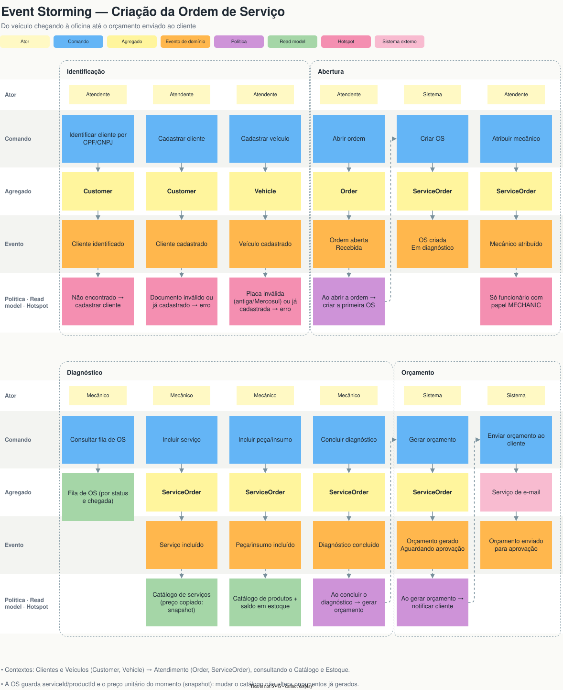
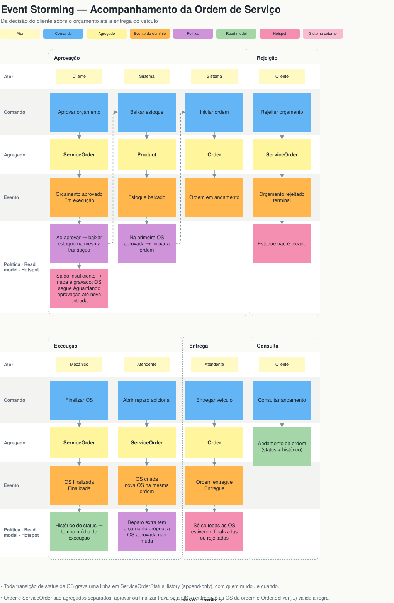
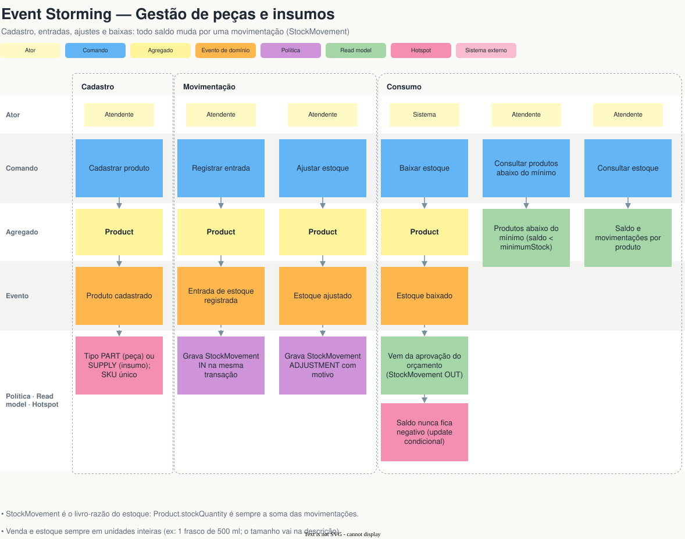
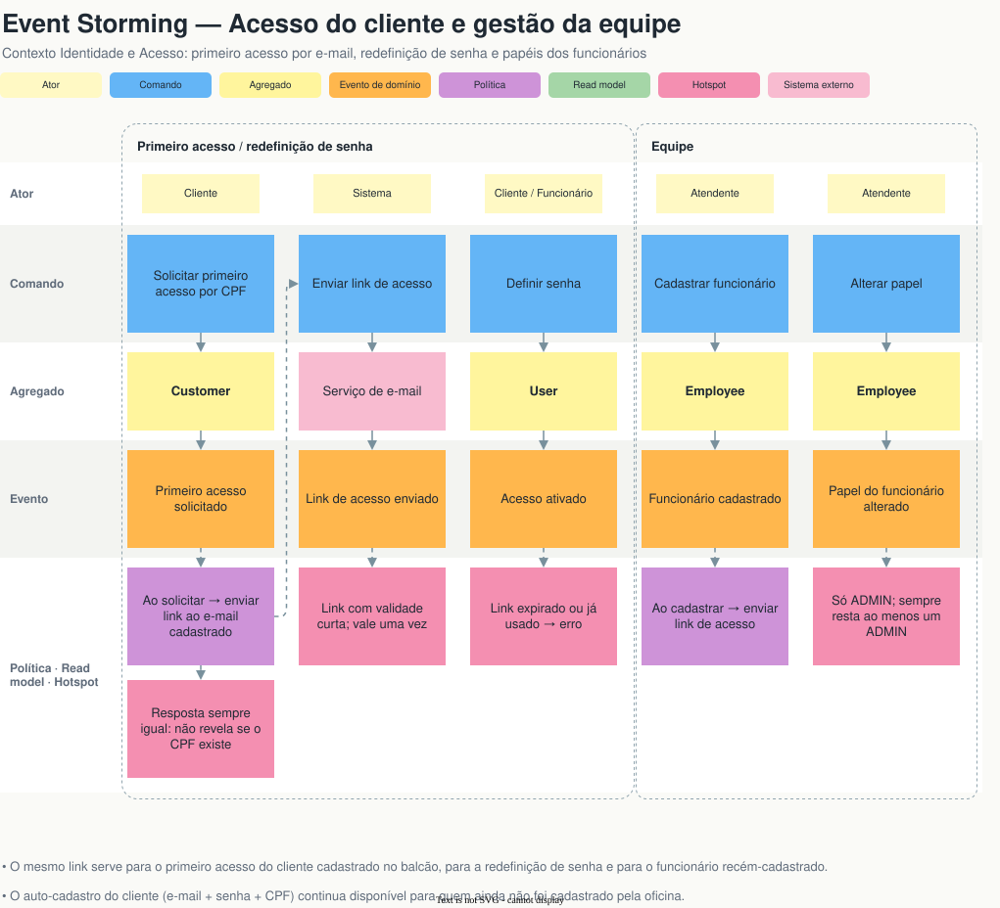

# Linguagem Ubíqua e Modelo de Domínio

Modelagem DDD do Sistema Integrado de Atendimento e Execução de Serviços da oficina. Este documento é a fonte dos nomes usados nos diagramas e no código: termo novo entra aqui antes de virar classe.

## Documentação visual

Todos os diagramas, em ordem e com imagem, estão no [índice da documentação DDD](README.md). Fontes e exports:

| Documento | Fonte | Imagens | PDF |
|---|---|---|---|
| Domain Storytelling As-Is e To-Be | `domain-storytelling/*.egn` (egon.io) | [`domain-storytelling/`](domain-storytelling/) | [diagramas.pdf](diagramas.pdf) |
| Event Storming (criação da OS, acompanhamento da OS, peças e insumos, acesso e equipe) | [event-storming.drawio](https://viewer.diagrams.net/?nav=1&url=https%3A%2F%2Fraw.githubusercontent.com%2F18-SOAT%2FTech.Challenge.API%2Fmain%2Fdocs%2Fddd%2Fevent-storming.drawio) | [`event-storming/`](event-storming/) | [event-storming.pdf](event-storming.pdf) |
| Diagramas (subdomínios, context map, agregados, máquinas de estado) | [diagramas.drawio](https://viewer.diagrams.net/?nav=1&url=https%3A%2F%2Fraw.githubusercontent.com%2F18-SOAT%2FTech.Challenge.API%2Fmain%2Fdocs%2Fddd%2Fdiagramas.drawio) | [`diagramas/`](diagramas/) | [diagramas.pdf](diagramas.pdf) |
| Modelo de dados | [database.drawio](../diagrams/database.drawio) | [database.svg](../diagrams/database.svg) | — |

Os links do `.drawio` abrem no viewer do diagrams.net, sem login. Como editar e exportar está no [índice](README.md#como-editar).

## Atores

| Ator | No código | Papel no domínio |
|---|---|---|
| Cliente | `Customer` (`UserType.CUSTOMER`) | Traz o veículo, aprova ou rejeita o orçamento, acompanha a OS |
| Atendente | `Employee` + `EmployeeRole.ADMIN` | Atendimento e gestão: identifica o cliente, abre a ordem, atribui o mecânico, cadastra catálogo, estoque e funcionários, entrega o veículo |
| Mecânico | `Employee` + `EmployeeRole.MECHANIC` | Consulta a fila, diagnostica, inclui serviços e peças, executa e finaliza a OS |
| Sistema | a API | Gera e envia o orçamento, envia o link de acesso, baixa o estoque, registra o histórico |
| Fornecedor | — (externo) | Entrega peças e insumos; não é modelado no código |

"Atendente" é o nome que a oficina usa para a função. No código, não existe um papel próprio: quem atende é o funcionário com papel `ADMIN`.

## Bounded contexts

| Contexto | Subdomínio | Responsabilidade | Módulos (`src/modules/`) |
|---|---|---|---|
| **Atendimento** | Core | Ordem (estadia do veículo), Ordem de Serviço, orçamento, aprovação, execução, fila de OS e tempo médio | `service-order` |
| **Catálogo e Estoque** | Suporte | Serviços oferecidos, peças/insumos e saldo de estoque | `inventory` |
| **Clientes e Veículos** | Suporte | Cadastro do cliente (CPF/CNPJ) e dos veículos dele | `customer`, `vehicle` |
| **Identidade e Acesso** | Genérico | Login, primeiro acesso e redefinição de senha, emissão e validação de JWT, papéis dos funcionários | `user`, `auth`, `employee` |
| *Notificações* | Genérico | Envio do link de acesso e do orçamento por e-mail; sem contexto próprio (port `EmailSender`) | `src/shared/infrastructure/email` |

Padrões de integração (ver o Context Map em `diagramas.drawio`):

- **Identidade → demais: Open Host Service.** O contrato estável é token + claims.
- **Clientes e Veículos → Atendimento: Cliente/Fornecedor.**
- **Catálogo e Estoque → Atendimento: Cliente/Fornecedor, com Atendimento Conformista.** O Atendimento copia preço e item como snapshot.
- **`src/shared/domain` como Shared Kernel:** `Email`, `Money`, `DomainError`, `IdGenerator`.
- **Sem ACL**, porque é um único monolito com a mesma linguagem.

Os contextos se referenciam **só por ID**. Uma OS guarda `productId` e `serviceId`, nunca o objeto do catálogo, e copia o preço no momento em que o item entra (snapshot). As FKs do banco garantem a integridade referencial; elas não servem para navegar entre agregados.

## Glossário

| Termo (negócio) | No código | Definição |
|---|---|---|
| Usuário | `User` | Credencial de login (e-mail + senha). Pode ser de um cliente ou de um funcionário (`UserType`). |
| Cliente | `Customer` | Dono do veículo, identificado pelo CPF/CNPJ. O login é opcional: o cliente pode existir só pelo cadastro feito na oficina. |
| Primeiro acesso | — (fluxo de `auth`) | O cliente cadastrado no balcão informa o CPF/CNPJ e recebe, no e-mail cadastrado, um link de acesso para definir a senha. |
| Link de acesso | token de acesso | Link enviado por e-mail para definir ou redefinir a senha. Tem validade curta e vale uma vez. |
| Documento (CPF/CNPJ) | `Document` (VO) | CPF (11 dígitos) ou CNPJ (14), só dígitos, com dígito verificador validado. |
| Telefone | `Phone` (VO) | DDD + número, 10 ou 11 dígitos. |
| E-mail | `Email` (VO) | Normalizado (trim + minúsculas) e validado. |
| Senha | `Password` (VO) | De 8 caracteres a 72 bytes (limite do bcrypt). Só o hash é persistido. |
| Funcionário | `Employee` | Pessoa da oficina com login e um papel (`EmployeeRole`), cadastrada pelo ADMIN. |
| Administrador / Atendente | `EmployeeRole.ADMIN` | Faz o atendimento e a gestão: abre ordens, cadastra clientes, catálogo, estoque e funcionários. |
| Mecânico | `EmployeeRole.MECHANIC` | Executa as OS. |
| Mecânico responsável | `ServiceOrder.assigneeId` | Mecânico atribuído pelo atendente a uma OS. |
| Veículo | `Vehicle` | Placa, marca, modelo e ano. Pertence a um cliente. |
| Placa | `LicensePlate` (VO) | Padrão antigo (`ABC1234`) ou Mercosul (`ABC1D23`), maiúscula e sem hífen. |
| Dinheiro | `Money` (VO) | Valor em reais com 2 casas decimais, nunca negativo. |
| Serviço | `Service` | Item do catálogo de mão de obra (ex: troca de óleo), com preço e duração estimada. |
| Produto | `Product` | Item físico vendido em unidades inteiras. O tamanho vai na descrição (ex: um frasco de 500 ml). |
| Peça | `ProductType.PART` | Produto que é instalado no veículo (ex: pastilha de freio). |
| Insumo | `ProductType.SUPPLY` | Produto consumido no serviço (ex: óleo, fluido). |
| Estoque mínimo | `Product.minimumStock` | Saldo abaixo do qual o produto aparece em "Produtos abaixo do mínimo". |
| Produtos abaixo do mínimo | read model | Consulta dos produtos com `stockQuantity < minimumStock`, usada pelo atendente para repor. |
| Movimentação de estoque | `StockMovement` | Lançamento no livro-razão do estoque: `IN` (entrada), `OUT` (saída/baixa), `ADJUSTMENT` (ajuste de inventário). Todo saldo muda por uma movimentação. |
| Baixa de estoque | `StockMovement` `OUT` | Saída das peças/insumos de uma OS, feita na aprovação do orçamento. |
| Ordem / Estadia | `Order` | Período do veículo na oficina, da chegada à entrega. Agrupa todas as OS da visita e tem número legível (`number`). |
| Ordem de Serviço (OS) | `ServiceOrder` | Unidade de trabalho com serviços e peças. Nasce como orçamento e, aprovada, vira a OS executada. |
| Fila de OS | read model | OS abertas ordenadas por status e data de chegada da ordem. É o que o mecânico consulta para saber o que fazer primeiro. |
| Orçamento | `ServiceOrder` em `AWAITING_APPROVAL` | Soma dos itens da OS, enviada ao cliente por e-mail para aprovar ou rejeitar. |
| Item de serviço / de produto | `ServiceItem` / `ProductItem` | Linha da OS com quantidade e **preço unitário congelado** no momento em que o item entra (snapshot). |
| Valor aprovado | `ServiceOrder.approvedAmount` | Total do orçamento congelado na aprovação. Mudança posterior no catálogo não altera a OS. |
| Reparo adicional | nova `ServiceOrder` na mesma `Order` | Problema achado durante a estadia. Gera uma OS nova, com orçamento próprio, sem alterar a já aprovada. |
| Histórico de status | `ServiceOrderStatusHistory` | Uma linha por transição (append-only), com quem mudou (`changedById`; `null` = cliente/sistema) e quando. Fonte do tempo médio de execução. |
| Status terminal | `FINISHED` ou `REJECTED` | OS que não muda mais. A Ordem só é entregue quando todas as OS estão terminais. |

## Status

O enunciado descreve um fluxo único de status. No modelo, ele se divide entre a **Ordem** (a estadia) e a **OS** (o trabalho):

| Enunciado | Enum | Agregado |
|---|---|---|
| Recebida | `OrderStatus.RECEIVED` | `Order` |
| Em diagnóstico | `ServiceOrderStatus.IN_DIAGNOSIS` | `ServiceOrder` |
| Aguardando aprovação | `ServiceOrderStatus.AWAITING_APPROVAL` | `ServiceOrder` |
| Em execução | `ServiceOrderStatus.IN_EXECUTION` (e `OrderStatus.IN_PROGRESS`) | `ServiceOrder` / `Order` |
| Finalizada | `ServiceOrderStatus.FINISHED` | `ServiceOrder` |
| Entregue | `OrderStatus.DELIVERED` | `Order` |
| *(orçamento recusado)* | `ServiceOrderStatus.REJECTED` | `ServiceOrder` |

Transições permitidas:

- **OS:** `IN_DIAGNOSIS → AWAITING_APPROVAL → IN_EXECUTION → FINISHED`, e `AWAITING_APPROVAL → REJECTED`.
- **Ordem:** `RECEIVED → IN_PROGRESS` (na primeira OS aprovada) `→ DELIVERED` (só com todas as OS terminais).

### Por que dois agregados com status

O veículo **chega e sai uma vez**, mas durante a estadia podem surgir **vários trabalhos**, cada um com orçamento e aprovação próprios. Um exemplo é o reparo adicional encontrado na execução, que o cliente pode aprovar ou recusar sem afetar o que já foi aprovado.

- **Recebida** e **Entregue** descrevem a estadia (`Order`).
- **Em diagnóstico** até **Finalizada** descrevem cada trabalho (`ServiceOrder`).

Com um status só, um reparo adicional obrigaria a voltar uma OS "Em execução" para "Aguardando aprovação", e o valor já aprovado se perderia. Separar os dois mantém cada orçamento íntegro e deixa as transações pequenas: aprovar uma OS trava só ela.

## Agregados

| Agregado (raiz) | Dentro do agregado | Value Objects | Invariantes principais |
|---|---|---|---|
| `User` | — | `Email`, `Password` | E-mail único; usuário inativo não autentica; o link de acesso vale uma vez. |
| `Customer` | — | `Document`, `Email`, `Phone` | Documento válido, único e imutável; e-mail obrigatório (canal de contato e do primeiro acesso), pode repetir entre clientes e funcionários (único é o e-mail de login, no `User`); não é excluído se tiver login, veículos ou OS. |
| `Employee` | — | — | Papel `ADMIN` ou `MECHANIC`, alterado só por ADMIN; sempre resta ao menos um ADMIN. |
| `Vehicle` | — | `LicensePlate` | Placa válida e única (pode ser corrigida ou convertida para Mercosul); pertence a um cliente (por ID), que não muda; ano entre 1900 e o ano seguinte ao atual; não é excluído se tiver OS. |
| `Service` | — | `Money` | Nome único no catálogo (sem diferenciar maiúscula); preço ≥ 0 com até 2 casas; duração estimada, se informada, em minutos > 0; inativo não entra em orçamento novo; não é excluído se já entrou em OS (desativa-se). |
| `Product` | `StockMovement` | `Money` | Saldo nunca negativo; todo saldo muda por movimentação. |
| `Order` | — | — | Entrega só com todas as OS terminais (regra validada em `Order.deliver(...)` com os status recebidos do use case). |
| `ServiceOrder` | `ServiceItem`, `ProductItem`, `ServiceOrderStatusHistory` | `Money` | Transições só pelo fluxo acima; responsável é MECHANIC; itens só antes do orçamento; aprovação congela o valor; toda transição grava histórico. |

`Order` e `ServiceOrder` são agregados **separados**. A OS referencia a Ordem pelo `orderId`. A regra que cruza os dois (entrega) fica no use case de entrega, que carrega as OS da Ordem e passa os status para a `Order` validar.

## Entidades

| Entidade | Agregado | Identidade e regra |
|---|---|---|
| `User` | `User` (raiz) | Identificado pelo `id`; e-mail único; senha só como hash. |
| `Customer` | `Customer` (raiz) | Identificado pelo `id`; único por `Document`. |
| `Employee` | `Employee` (raiz) | Identificado pelo `id`; sempre ligado a um `User` do tipo `EMPLOYEE`. |
| `Vehicle` | `Vehicle` (raiz) | Identificado pelo `id`; único por placa. |
| `Service` | `Service` (raiz) | Identificado pelo `id`; nome único no catálogo. |
| `Product` | `Product` (raiz) | Identificado pelo `id`; SKU único. |
| `StockMovement` | `Product` | Lançamento imutável do livro-razão; só nasce por um método do `Product`. |
| `Order` | `Order` (raiz) | Identificado pelo `id` e pelo `number` legível. |
| `ServiceOrder` | `ServiceOrder` (raiz) | Identificado pelo `id`; ciclo de vida pela máquina de estados. |
| `ServiceItem`, `ProductItem` | `ServiceOrder` | Linhas da OS; só mudam enquanto a OS está em diagnóstico. |
| `ServiceOrderStatusHistory` | `ServiceOrder` | Linha imutável por transição (append-only). |

## Objetos de Valor

Value Objects não têm identidade: dois com o mesmo valor são iguais. São imutáveis e se validam na criação. Um VO inválido não existe.

| VO | Regra | Usado em |
|---|---|---|
| `Email` | trim + minúsculas + formato válido | `User`, `Customer` |
| `Password` | 8 caracteres a 72 bytes; nunca persistido (vira hash) | `User` |
| `Document` | CPF (11) ou CNPJ (14) só dígitos, dígito verificador válido | `Customer` |
| `Phone` | DDD + número, 10 ou 11 dígitos | `Customer` |
| `LicensePlate` | `ABC1234` ou `ABC1D23`, maiúscula, sem hífen | `Vehicle` |
| `Money` | reais com 2 casas, ≥ 0 | `Service`, `Product`, itens e `approvedAmount` da OS |

## Eventos de domínio no código

Os eventos **não viram classes**. No MVP, nenhum consumidor reage a eles de forma assíncrona: as políticas rodam no mesmo use case, dentro da mesma transação. Cada evento é o resultado de um **método da entidade**, que valida a regra e muda o estado, e deixa um **registro persistido** como prova.

| Evento | Método | Registro persistido |
|---|---|---|
| `Cliente cadastrado` | `Customer.create()` | linha em `customers` |
| `Dados do cliente alterados` | `Customer.update()` | `customers` (nome, e-mail, telefone) |
| `Cliente excluído` | `Customer.assertCanBeRemoved()` + `CustomerRepository.delete()` | linha removida de `customers` |
| `Veículo cadastrado` | `Vehicle.create()` | linha em `vehicles` |
| `Dados do veículo alterados` | `Vehicle.update()` | `vehicles` (placa, marca, modelo, ano) |
| `Veículo excluído` | `VehicleRepository.delete()` | linha removida de `vehicles` |
| `Serviço cadastrado` | `Service.create()` | linha em `services` (ativo) |
| `Dados do serviço alterados` | `Service.update()` | `services` (nome, descrição, preço, duração) |
| `Serviço desativado` / `Serviço reativado` | `Service.deactivate()` / `activate()` | `services.active` |
| `Serviço excluído` | `ServiceRepository.delete()` | linha removida de `services` |
| `Ordem aberta` | `Order.open()` | `orders` em `RECEIVED` |
| `OS criada` | `ServiceOrder.create()` | `service_orders` + histórico `IN_DIAGNOSIS` |
| `Mecânico atribuído` | `ServiceOrder.assign(mechanicId)` | `service_orders.assignee_id` |
| `Serviço incluído` / `Peça/insumo incluído` | `ServiceOrder.addService()` / `addProduct()` | `service_items` / `product_items` com preço snapshot |
| `Diagnóstico concluído` → `Orçamento gerado` | `ServiceOrder.completeDiagnosis()` | histórico `AWAITING_APPROVAL` |
| `Orçamento enviado para aprovação` | `EmailSender.send()` no use case | — (efeito externo) |
| `Orçamento aprovado` | `ServiceOrder.approve()` | histórico `IN_EXECUTION` + `approved_amount` / `approved_at` |
| `Estoque baixado` | `Product.withdraw(qty)` | `stock_movements` `OUT` com `service_order_id` |
| `Ordem em andamento` | `Order.start()` | `orders` em `IN_PROGRESS` |
| `Orçamento rejeitado` | `ServiceOrder.reject()` | histórico `REJECTED` |
| `OS finalizada` | `ServiceOrder.finish()` | histórico `FINISHED` |
| `Ordem entregue` | `Order.deliver(statusDasOS)` | `orders` em `DELIVERED` + `delivered_at` |
| `Produto cadastrado` | `Product.create()` | linha em `products` |
| `Entrada de estoque registrada` | `Product.receive(qty)` | `stock_movements` `IN` |
| `Estoque ajustado` | `Product.adjust(qty, reason)` | `stock_movements` `ADJUSTMENT` |
| `Primeiro acesso solicitado` → `Link de acesso enviado` | use case de primeiro acesso + `EmailSender.send()` | — (token assinado, não persistido) |
| `Acesso ativado` | `User.create()` / `User.changePassword()` | linha em `users` (+ `customers.user_id`) |
| `Funcionário cadastrado` | `Employee.create()` | `users` + `employees` |
| `Papel do funcionário alterado` | `Employee.changeRole(role)` | `employees.role` |

Se no futuro uma política precisar rodar fora da transação (ex: um e-mail com reenvio), aí sim o evento vira objeto e é publicado depois do commit. Até lá, a classe seria cerimônia sem consumidor.

## Regras de negócio detalhadas

### Acesso do cliente e da equipe

- **Auto-cadastro:** quem ainda não é cliente se cadastra com e-mail, senha, CPF/CNPJ e telefone. Isso cria `User` e `Customer` numa transação.
- **Primeiro acesso:**
  1. o cliente cadastrado no balcão informa o CPF/CNPJ;
  2. se existir cadastro, o Sistema envia ao **e-mail cadastrado pela oficina** um link de acesso;
  3. pelo link, o cliente define a senha, e isso cria o `User` e o liga ao `Customer`.
- A resposta é sempre a mesma, com ou sem cadastro, para não revelar quais CPFs são clientes (proteção contra enumeração). Quem prova a posse da conta é o acesso ao e-mail, não o CPF.
- **Redefinição de senha:** mesmo fluxo, a partir do e-mail.
- **Funcionários:** o ADMIN cadastra o funcionário (nome, e-mail, papel) e o Sistema envia o link de acesso. O ADMIN pode alterar o papel depois, mas o último ADMIN não pode deixar de ser ADMIN.
- **Link de acesso:** token assinado com finalidade "definir senha" e validade curta. Ele **vale uma vez** porque deixa de ser aceito assim que a senha é definida.

### Saldo insuficiente na aprovação

A aprovação e a baixa de estoque acontecem na mesma transação ([padrão de transações](../code/patterns/repository.md#transações-port-nomeado-pela-operação)). Se algum produto não tiver saldo:

- a transação é desfeita inteira e o cliente recebe o erro de estoque insuficiente;
- a OS continua `AWAITING_APPROVAL`, com o mesmo orçamento;
- o atendente registra a entrada do produto (ele aparece em "Produtos abaixo do mínimo") e o cliente aprova de novo.

### Tempo médio de execução

- **Por OS:** `changedAt(FINISHED) − changedAt(IN_EXECUTION)`, lidos do `ServiceOrderStatusHistory`.
- **Global:** média do tempo das OS finalizadas.
- **Por serviço do catálogo:** média do tempo das OS finalizadas que contêm aquele serviço. É uma aproximação, porque uma OS com vários serviços conta para cada um deles.

## Event Storming em texto

Legenda: *Comando*, `Evento`, ⟶ política. A notação visual está em [event-storming/1-legenda.svg](event-storming/1-legenda.svg).

### 1. Criação da OS

| Ator | Comando | Agregado | Evento | Política / observação |
|---|---|---|---|---|
| Atendente | *Identificar cliente por CPF/CNPJ* | `Customer` | `Cliente identificado` | Não encontrado ⟶ cadastrar |
| Atendente | *Cadastrar cliente* | `Customer` | `Cliente cadastrado` | Documento inválido ou duplicado ⟶ erro |
| Atendente | *Cadastrar veículo* | `Vehicle` | `Veículo cadastrado` | Placa inválida ou duplicada ⟶ erro |
| Atendente | *Abrir ordem* | `Order` | `Ordem aberta` (Recebida) | ⟶ criar a primeira OS |
| Sistema | *Criar OS* | `ServiceOrder` | `OS criada` (Em diagnóstico) | |
| Atendente | *Atribuir mecânico* | `ServiceOrder` | `Mecânico atribuído` | Só funcionário com papel MECHANIC |
| Mecânico | *Consultar fila de OS* | read model | — | OS ordenadas por status e chegada |
| Mecânico | *Incluir serviço* | `ServiceOrder` | `Serviço incluído` | Preço copiado do catálogo (snapshot) |
| Mecânico | *Incluir peça/insumo* | `ServiceOrder` | `Peça/insumo incluído` | Preço copiado do catálogo (snapshot) |
| Mecânico | *Concluir diagnóstico* | `ServiceOrder` | `Diagnóstico concluído` | ⟶ gerar orçamento |
| Sistema | *Gerar orçamento* | `ServiceOrder` | `Orçamento gerado` (Aguardando aprovação) | ⟶ notificar o cliente |
| Sistema | *Enviar orçamento ao cliente* | — | `Orçamento enviado para aprovação` | Sistema externo: e-mail |

### 2. Acompanhamento da OS

| Ator | Comando | Agregado | Evento | Política / observação |
|---|---|---|---|---|
| Cliente | *Aprovar orçamento* | `ServiceOrder` | `Orçamento aprovado` (Em execução) | Valor congelado; ⟶ baixar estoque e gravar histórico **na mesma transação** |
| Sistema | *Baixar estoque* | `Product` | `Estoque baixado` | Saldo insuficiente ⟶ nada é gravado; OS segue Aguardando aprovação |
| Sistema | *Iniciar ordem* | `Order` | `Ordem em andamento` | Na primeira OS aprovada |
| Cliente | *Rejeitar orçamento* | `ServiceOrder` | `Orçamento rejeitado` | Status terminal; estoque intocado |
| Mecânico | *Finalizar OS* | `ServiceOrder` | `OS finalizada` | Fecha o tempo de execução (histórico) |
| Atendente | *Abrir reparo adicional* | `ServiceOrder` | `OS criada` | Nova OS na mesma Ordem, com orçamento próprio |
| Atendente | *Entregar veículo* | `Order` | `Ordem entregue` | Só se todas as OS estiverem terminais |
| Cliente | *Consultar andamento* | read model | — | Status atual + histórico das OS da Ordem (cliente autenticado) |
| — | — | `ServiceOrder` | (qualquer transição) | ⟶ toda transição grava uma linha em `ServiceOrderStatusHistory` |

### 3. Gestão de peças e insumos

| Ator | Comando | Agregado | Evento | Política / observação |
|---|---|---|---|---|
| Atendente | *Cadastrar produto* | `Product` | `Produto cadastrado` | Tipo `PART` ou `SUPPLY`; SKU único |
| Atendente | *Registrar entrada* | `Product` | `Entrada de estoque registrada` | Gera `StockMovement` `IN` na mesma transação |
| Atendente | *Ajustar estoque* | `Product` | `Estoque ajustado` | Gera `StockMovement` `ADJUSTMENT`; motivo obrigatório |
| Sistema | *Baixar estoque* | `Product` | `Estoque baixado` | Vem da aprovação do orçamento; `StockMovement` `OUT` com `serviceOrderId` |
| Atendente | *Consultar produtos abaixo do mínimo* | read model | — | `stockQuantity < minimumStock` |
| Atendente | *Consultar estoque* | read model | — | Saldo e movimentações por produto |

### 4. Acesso e equipe

| Ator | Comando | Agregado | Evento | Política / observação |
|---|---|---|---|---|
| Cliente | *Solicitar primeiro acesso por CPF* | `Customer` | `Primeiro acesso solicitado` | ⟶ enviar link ao e-mail cadastrado; resposta sempre igual |
| Sistema | *Enviar link de acesso* | — | `Link de acesso enviado` | Sistema externo: e-mail; link com validade curta |
| Cliente / Funcionário | *Definir senha* | `User` | `Acesso ativado` | Link expirado ou já usado ⟶ erro |
| Atendente | *Cadastrar funcionário* | `Employee` | `Funcionário cadastrado` | ⟶ enviar link de acesso |
| Atendente | *Alterar papel* | `Employee` | `Papel do funcionário alterado` | Só ADMIN; sempre resta um ADMIN |

## Relação com o código

Cada elemento do modelo e o arquivo onde ele vive.

| Elemento | Tipo | Caminho |
|---|---|---|
| `User` | Entidade (raiz) | `src/modules/user/domain/entities/user.entity.ts` |
| `Password` | VO | `src/modules/user/domain/value-objects/password.vo.ts` |
| `Email` | VO (Shared Kernel) | `src/shared/domain/value-objects/email.vo.ts` |
| `Money` | VO (Shared Kernel) | `src/shared/domain/value-objects/money.vo.ts` |
| `UserType` | Enum | `src/modules/user/domain/enums/user-type.enum.ts` |
| `Customer` | Entidade (raiz) | `src/modules/customer/domain/entities/customer.entity.ts` |
| `Document` | VO | `src/modules/customer/domain/value-objects/document.vo.ts` |
| `Phone` | VO | `src/modules/customer/domain/value-objects/phone.vo.ts` |
| `Employee` | Entidade (raiz) | `src/modules/employee/domain/entities/employee.entity.ts` |
| `EmployeeRole` | Enum | `src/modules/employee/domain/enums/employee-role.enum.ts` |
| `Vehicle` | Entidade (raiz) | `src/modules/vehicle/domain/entities/vehicle.entity.ts` |
| `LicensePlate` | VO | `src/modules/vehicle/domain/value-objects/license-plate.vo.ts` |
| `Service` | Entidade (raiz) | `src/modules/inventory/domain/entities/service.entity.ts` |
| `Product` | Entidade (raiz) | `src/modules/inventory/domain/entities/product.entity.ts` |
| `StockMovement` | Entidade | `src/modules/inventory/domain/entities/stock-movement.entity.ts` |
| `ProductType`, `StockMovementType` | Enums | `src/modules/inventory/domain/enums/` |
| `Order` | Entidade (raiz) | `src/modules/service-order/domain/entities/order.entity.ts` |
| `ServiceOrder` | Entidade (raiz) | `src/modules/service-order/domain/entities/service-order.entity.ts` |
| `ServiceItem`, `ProductItem` | Entidades | `src/modules/service-order/domain/entities/service-item.entity.ts`, `product-item.entity.ts` |
| `ServiceOrderStatusHistory` | Entidade | `src/modules/service-order/domain/entities/service-order-status-history.entity.ts` |
| `OrderStatus`, `ServiceOrderStatus` | Enums | `src/modules/service-order/domain/enums/` |
| Aprovação atômica (aprovar + baixar estoque + histórico) | Port + adapter | `src/modules/service-order/domain/ports/service-order-approval.repository.ts` |
| Cadastro atômico (User + Customer) | Port + adapter | `src/modules/auth/domain/ports/customer-registration.repository.ts` |
| Envio de e-mail (link de acesso, orçamento) | Port | `src/shared/infrastructure/email/email-sender.port.ts` |
| Erros de domínio | Catálogos por contexto | `src/modules/*/domain/errors/*.error.ts` |
| Persistência | Prisma | `prisma/schema.prisma` |
